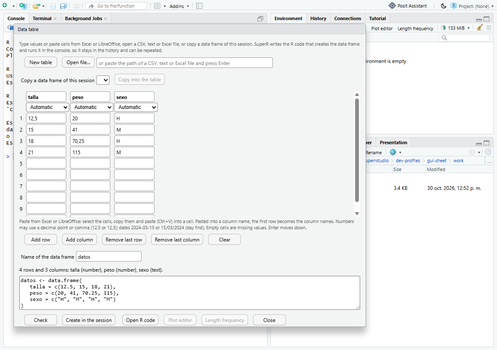

# Data table: type, paste or load data

Status 2026-10-30: implemented and desktop-verified on the development
build (`tools/superrstudio/test-gui-scatter.ps1 -Scenario sheet`). Opt-in
with the other SuperR features (`SUPER_RSTUDIO_EXPERIMENTAL=1`, set by the
packaged app).

The **Data table** button in the Environment pane ("Tabla de datos" in
Spanish) opens a non-modal window that creates a data frame in the R session
from any of these sources:

- **values typed** into a small table, or **cells pasted** from Excel or
  LibreOffice;
- a **CSV or text file**, or an **Excel workbook** (`.xlsx`, `.xls`), chosen
  with *Open file…* or typed or pasted as a path (Enter reads it);
- a **copy of a data frame of the session**, to correct values and create
  it again under a new name or in its place.

SuperR writes the R code that creates the data frame and **runs it in the
console**, so the object is created visibly and the code is in the history.
It is ordinary R (`data.frame(...)`, `utils::read.csv(...)`,
`readxl::read_excel(...)`), so a script can repeat it. *Open R code* opens
it in a new script. Nothing is written to files and no data frame changes
until you click **Create in the session**. If an object with that name
already exists, the window asks first (*Replace …*).

After creation, **Plot editor** and **Length frequency** open those windows
with the new data frame already selected.

## Typing and pasting

- Each column has a name and a type: **Automatic** (number, then date, then
  text, whichever fits every value), **Number**, **Text** or **Date**. *Check*
  shows the types found and the code.
- Numbers may use a decimal point or a decimal comma (`12.5` or `12,5`).
- Dates may be `2024-03-15`, `2024/03/15`, `15/03/2024`, `15-03-2024` or
  `15.03.2024`. Forms with the year last are read **day first**, as in
  Spanish-speaking countries. Impossible dates (31/02/2024) are errors in a
  Date column and keep an Automatic column as text.
- Empty cells and `NA` are missing values. Rows after the last value and
  columns with neither a name nor a value are ignored.
- Paste spreadsheet cells (tab-separated) into any cell; the table grows as
  needed. Pasted into a **column name**, the first line becomes the column
  names. Enter and the arrow keys move between rows; Tab moves right.
- A value that does not fit its type is reported with its column and row
  (`Column 'talla', row 2: 'doce' is not a number.`), and nothing runs.
- Limits: 2,000 rows and 100 columns. Load larger data from a file.
- Text columns stay text. On R older than 4.0, where `data.frame()` and
  `read.csv()` would make factors, the code adds `stringsAsFactors = FALSE`.
- Column names that are not syntactic R names (`Talla (cm)`) are kept,
  with `check.names = FALSE`. The data frame's name must be a syntactic name
  (`datos`, `capturas_2024`).

## Files

The window reads the file, shows **how it read it** and a preview of the
first 50 rows, and writes the code with the simplest standard reader:

| File | Detected | Code |
| --- | --- | --- |
| Comma-separated, decimal point | `,` | `utils::read.csv(path)` |
| Semicolon-separated, decimal comma (Spanish Excel CSV) | `;` and `,` | `utils::read.csv2(path)` |
| Tab-separated | tab | `utils::read.delim(path)` / `read.delim2` |
| Other separators, spaces | `|`, spaces | `utils::read.table(path, header, sep, dec, ...)` |
| Excel | sheets | `as.data.frame(readxl::read_excel(path, sheet = "..."))` |

- **Detection.**
  - The separator is the candidate that splits every sample line into the same number of fields (tab, then semicolon, comma and vertical bar); otherwise spaces.
  - The decimal comma is detected for files not separated by commas.
  - The header is assumed unless the first line contains a number.
  - The encoding is UTF-8 with or without a BOM; otherwise Latin-1. The code adds `fileEncoding` when it is not plain UTF-8.
  - Every detected setting can be changed; *Read again* rereads the file.
- **Large files.** Files over 50 MB are previewed from their first 1,000 rows, and the row count comes from counting lines (shown as approximate). The code always reads the whole file.
- **Refused files.** UTF-16 and binary files are refused, with advice to save them as UTF-8 CSV.
- **Excel.** Reading Excel needs the **readxl** package. As with ggplot2 and TropFishR, it is offered for installation only with your consent (`DependencyDialog`, feature `sheet`). Text files need no package.

RStudio's own *Import Dataset* menu (from text, readr, Excel, SPSS, SAS,
Stata) stays available next to the button.

## Implementation

| Part | File |
| --- | --- |
| Window (GWT) | `src/gwt/.../views/superrstudio/SheetDialog.java` |
| Texts, English and Spanish | `tools/superrstudio/i18n/sheet_messages.py` → `SheetMessages.java`, `SheetMessagesEs.java`, `SheetMessages_es.properties` |
| Session operations `sheet_list`, `sheet_shape`, `sheet_get`, `sheet_build`, `sheet_file` | `src/cpp/session/modules/SessionSuperRStudioSheet.R` (sourced by `SessionSuperRStudio.cpp`; dispatched by the `sheet_` prefix of the shared `superrstudio_data` RPC) |
| Environment pane button | `EnvironmentPane.createSheetButton()` (an integration point) |
| Opening another window with a data frame selected | `ScatterDialog.openWith`, `LfqDialog.openWith` |
| Excel dependency | `superrstudioDependencyFeatures()` → `sheet` = readxl ≥ 1.4.0 |

Code is built as R language objects and deparsed (`deparse`), never by
pasting user text into code, and it is checked with `parse()` before it is
shown. The session functions never assign into the user's environment. The
window sends the code with `SendToConsoleEvent`. When the console returns
to its prompt, the window checks the result with `sheet_shape` (the data
frame exists with the expected rows and columns) before it reports success.
Otherwise it points to the message in the console.

## Tests

| Test | Covers |
| --- | --- |
| `tests/superrstudio/data-entry.R` (R 4.6.1 and 3.6.3; CI) | Typed tables with decimal commas, day-first dates, text, missing values, empty rows and columns, explicit types and their errors, name checks, copies of session data frames, text files (comma; semicolon with decimal comma in Latin-1; tab; BOM; no header; spaces; overrides; large files; UTF-16 and missing files refused) and Excel sheets. Every generated code is evaluated and compared |
| `tests/superrstudio/desktop-sheet.cjs` (`test-gui-scatter.ps1 -Scenario sheet`) | In the desktop: pasted and typed cells; creation through the console; plot editor and length-frequency window with the new data frame; replacement after confirmation; a Latin-1 CSV and an Excel sheet from typed paths; an edited copy; an invalid value |
