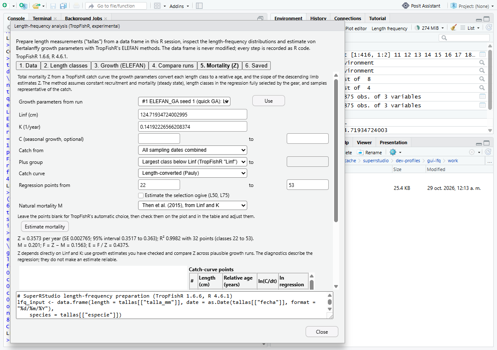
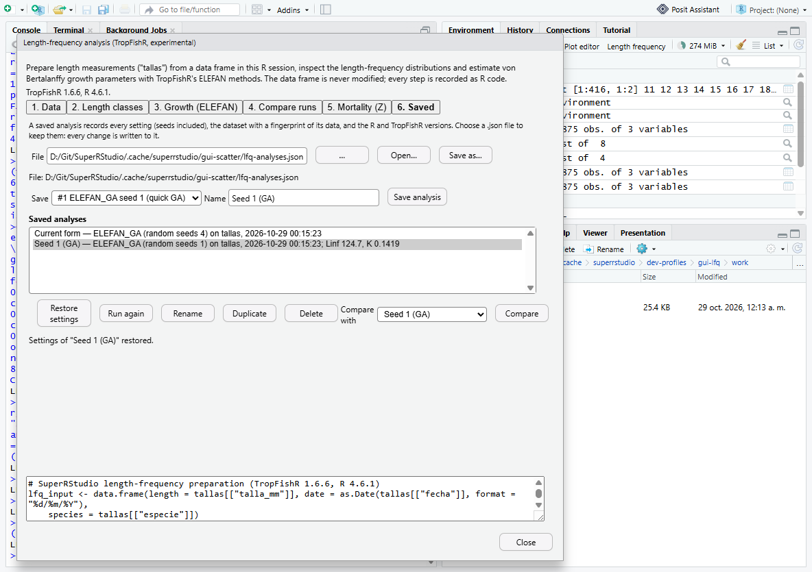
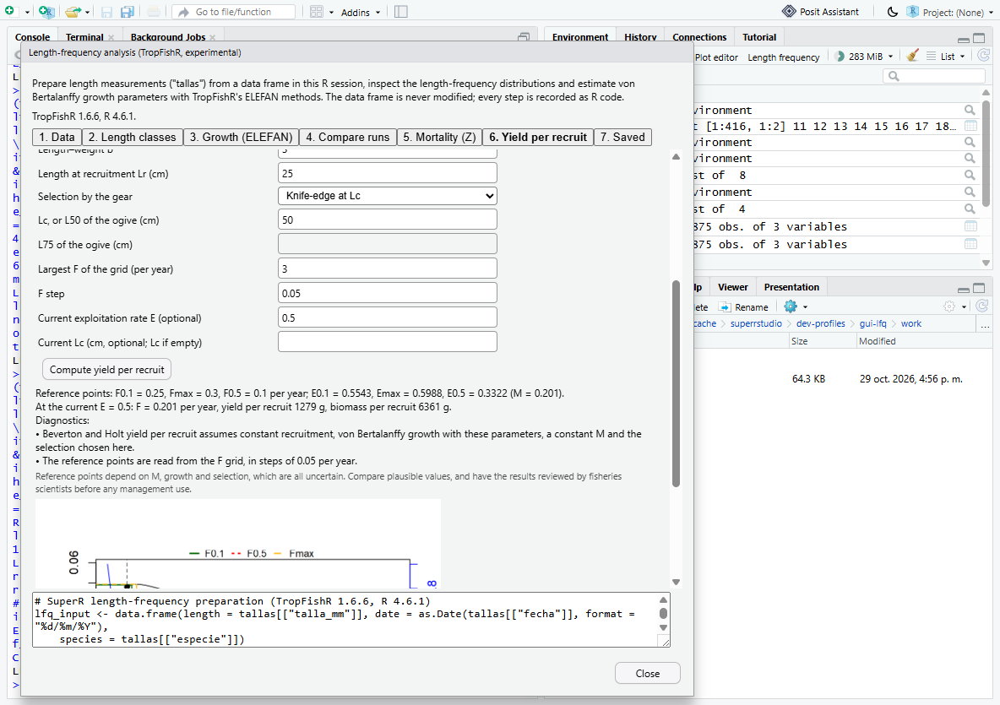

# Length-frequency analysis with TropFishR

Status 2026-10-29: **experimental, desktop-verified**, opt-in with
`SUPER_RSTUDIO_EXPERIMENTAL=1` (Environment toolbar: *Length frequency*).
TropFishR is optional: without it the window explains how to install it and
the data checks still work. The scientific interpretation has **not** been
reviewed by a fisheries scientist yet; see *Limitations*.

## Why

Researchers who analyse length measurements ("tallas") report different
TropFishR results for what they believe is the same analysis. This module
does not assume the package has a bug. Instead it:
- makes visible and records every input that changes an estimate;
- runs TropFishR's own functions unchanged;
- lets the same analysis be repeated with controlled seeds, saved, restored
  and compared.

Sources of differing results found in the TropFishR 1.6.6 source and
documentation (verified, not assumed):

| Source | Evidence |
| --- | --- |
| `ELEFAN_GA` is stochastic | `seed = NULL` by default and is passed to `GA::ga(seed = )`. The same seed gives identical estimates; different seeds differ. In the synLFQ7 test with a small GA, seed 1 gave Linf 124.7 / K 0.142 and seed 2 gave Linf 118 / K 0.249. |
| `ELEFAN_SA` stops on wall-clock time by default | `SA_time = 60` sets GenSA's `control$max.time`. GenSA's internal seed is fixed (`-100377`), so iteration-limited runs are reproducible, but time-limited runs depend on computer speed and load. |
| Scores are not comparable across methods | The `ELEFAN_GA` documentation says its fitness value "is not comparable with the score value of the other ELEFAN functions". |
| Restructuring settings | `MA` (an odd number of classes) and `addl.sqrt` change the restructured scores that every method fits. |
| Length classes | `bin_size` and `Lmin` define the classes. `lfqCreate` adds one empty class above the largest length. |
| Silent data handling in `lfqCreate` | Zero lengths are dropped. Negative lengths and lengths below `Lmin` fall outside every class and are ignored. `plus_group = TRUE` without a value waits for console input. |
| `lfqModify` keeps stale `rcounts` | Every element it does not rebuild, including `rcounts`, `peaks_mat` and `ASP`, is copied from its input. After a date subset or aggregation, the data must be restructured again. The module always restructures last. |
| Search ranges | `ELEFAN_GA` derives its default Linf range from the largest class in the data. The module records the range it actually used. |
| Date grouping | Monthly aggregation (`lfqCreate`) moves every sample to the 15th. Quarterly aggregation (`lfqModify`) moves samples to 15 February, May, August or November. |
| `catchCurve` and seasonal growth | Linf, K, C and ts are read from `par`, but the seasonal VBGF is used only when `C` and `ts` are also top-level elements of the data list. The generated code adds them explicitly. |
| `catchCurve` on length data | A catch matrix needs `catch_columns`; without them the function stops. `vectorise_catch` drops empty classes at both ends, which renumbers the regression points. The module therefore uses `catch_columns`, and point numbers always refer to the object shown. |
| Automatic regression points | `auto = TRUE` regresses from the class after the highest point to the last class with ln(C/dt) > 0.2. The module reports this choice and turns it into explicit `reg_int` values. |

## Workflow (seven tabs)

1. **Data**
   - Choose a data frame, the length column and its unit (cm, mm or m), and the sampling-date column (Date/POSIXct, or text with an explicit format).
   - Optionally choose a frequency column (aggregated data), a species column and species, and a sampling period (from/to, YYYY-MM-DD).
   - *Check data* reports how many rows each rule removes and the number of individuals per sampling date. The rules are: other species, missing or non-numeric length, zero or negative length, below the smallest class, missing or unparseable date, outside the sampling period, and missing or negative frequency.
2. **Length classes**
   - Set the class width and the smallest class.
   - *Combine samples*: none, by month (`lfqCreate(aggregate_dates = TRUE)`) or by quarter (`lfqModify(aggregate = "quarter")`).
   - Set the plus group (always passed as `c(TRUE, value)`), the moving average and the additional square-root transformation.
   - *Create* runs `lfqCreate()`, optionally `lfqModify()`, then `lfqRestructure()`. It lists every transformation in order and shows TropFishR's plots and the generated code.
3. **Growth (ELEFAN)**
   - Three methods:
     - `ELEFAN_GA`: seeds such as `1-10`, population, generations, stop rule, mutation, crossover and elitism.
     - `ELEFAN_SA`: an iteration or time limit, temperature and starting values.
     - `ELEFAN`: a Linf/K grid.
   - Search ranges are explicit, and seasonal growth (C, ts) is optional.
   - Runs execute in a separate `Rscript` process with progress reports and *Cancel*.
4. **Compare runs**
   - A table of every run with its full configuration and estimates.
   - The spread across seeds for each configuration.
   - **What differs between configurations**, named by category: data or filters, length classes, combination of samples, restructuring, search ranges, optimisation method, optimiser settings, random seeds, and R or TropFishR version. Only options the method uses are compared; for example, SA settings never make two GA runs differ.
   - Notes when scores are not comparable, the growth curves, and the R script of each run.
5. **Mortality (Z)**: total mortality with TropFishR catch curves.
   - Inputs:
     - Growth parameters: copied from a recorded run, or typed in.
     - The catch: all sampling dates combined, or one sampling year.
     - The plus group: TropFishR's `"Linf"` rule, none, or a class midpoint.
     - The method: length-converted (Pauly) or cumulative (Jones and van Zalinge).
   - Regression points are chosen automatically first and then edited; their numbers appear in the points table and the plot. The selection ogive (L50, L75) is optional.
   - Natural mortality comes from `M_empirical()`: Then et al. (2015) from growth or from maximum age, Pauly (1980) with temperature, or a known value. F = Z − M and E = F/Z follow from it.
   - Diagnostics:
     - automatic point choice;
     - a regression starting at or before the peak (classes not fully selected, Z biased low);
     - fewer than five points;
     - R² below 0.8;
     - a standard error above 25 % of Z;
     - lengths of at least 90 % of Linf;
     - classes without age (≥ Linf);
     - F < 0.
   - The text states the method's assumptions: steady state, full selection of the classes in the regression, and representative samples. **A diagnostic list does not declare an estimate reliable.**
6. **Yield per recruit**: Beverton–Holt Z from mean length and yield per recruit. Both use Linf, K and M as chosen in the Mortality tab.
   - **Z from mean length** (`Z_BevertonHolt`):
     - Formula: Z = K (Linf − L̄) / (L̄ − L′), where L̄ is the mean length of the fish at or above L′, the smallest fully selected length (a class midpoint). TropFishR uses the lower bound of that class.
     - Reports Z, L̄, the number of fish used, and M, F and E when M is chosen.
     - The plot shows the catch by length with L′, L̄ and Linf.
     - **TropFishR 1.6.6 detail:** `Z_BevertonHolt()` reads `Linf` and `K` from the top level of its argument, not from `$par`. With an `lfqModify()` object it silently returns an empty Z. The generated code therefore sets `lfq_bh$Linf` and `lfq_bh$K` explicitly, and the tests pin this behaviour.
     - Diagnostics:
       - the equilibrium assumption (always shown);
       - L′ below the most frequent class (not fully selected; Z biased);
       - fewer than 100 fish at or above L′;
       - L̄ at least 90 % of Linf;
       - F < 0.
   - **Yield per recruit, Beverton and Holt** (`predict_mod(type = "ypr")`, length-based):
     - Inputs:
       - length–weight a and b;
       - the length at recruitment Lr;
       - selection: knife-edge at Lc, or a trawl-type ogive (L50, L75) on the data's length classes;
       - the F grid (largest F and step);
       - optionally the current E and Lc.
     - Reports F0.1, Fmax and F0.5, with the matching E, M, and at the current E the F, yield per recruit and biomass per recruit. The plot is TropFishR's.
     - Diagnostics:
       - the model's assumptions (always shown);
       - the grid step limits the precision of the reference points;
       - Fmax at the end of the grid (extend the range);
       - the current E above Emax.

       These are statements of fact about the model; they do not judge stock status.
7. **Saved analyses**: a versioned JSON file (see below).
   - Save the current settings, or the configuration of a recorded run with its seed and estimates (this duplicates a previous run).
   - Restore, *Run again* (restore, create, run), rename, duplicate, delete, and compare two saved analyses setting by setting.

The data frame is never modified. Every step is also R code that reproduces it, and analyses are refused if the data frame changed after the LFQ was created.

### Saved-analysis file format (version 1)

```json
{
  "format": "superrstudio-lfq-analyses",
  "version": 1,
  "analyses": [
    {
      "id": "a1-20261029001303", "name": "Seed 1 (GA)", "created": "2026-10-29T00:13:03",
      "source": "run run1", "dataset": "tallas",
      "data": {"rows": 27875, "columns": ["talla_mm", "fecha", "especie"], "md5": "…"},
      "environment": {"r": "4.6.1", "tropfishr": "1.6.6"},
      "settings": {"length": "talla_mm", "bin_size": 2, "ma": 7, "method": "ga", "seeds": "1", …},
      "results": [{"method": "ELEFAN_GA", "seed": 1, "linf": 124.72, "k": 0.1419, …}]
    }
  ]
}
```

- `data.md5` is the MD5 of a canonical text form of the mapped columns: their name, class and values. It does not depend on R's serialisation format.
- Reading is strict:
  - It refuses invalid JSON, another or a newer format, unknown settings, values of the wrong type, settings the dialog would reject (for example an even moving average), a malformed fingerprint and duplicate ids.
  - The JSON reader and writer are part of the module (no optional package) and are tested for exactness, including quotes, backslashes and non-ASCII text.
  - Writes go to a temporary file that then replaces the target.
- Restoring warns and never substitutes when:
  - the dataset is missing (the user must choose a dataset; *Run again* does not run);
  - columns are missing;
  - the data changed (fingerprint);
  - the TropFishR or R version differs.

Each warning has a stable code, so the window shows it in its own language.

## Design

| Layer | File | Notes |
| --- | --- | --- |
| R | `SessionSuperRStudioLfq.R` | Data mapping, preparation, background runner, run records and the comparison of configurations (`lfq_*` through the existing `superrstudio_data` RPC). |
| R | `SessionSuperRStudioLfqLibrary.R` | Saved analyses (`lfq_lib*`), file format, strict JSON reader and writer. |
| R | `SessionSuperRStudioLfqMortality.R` | Catch curves, M, F, E and diagnostics (`lfq_mortality`). |
| C++ | `SessionSuperRStudio.cpp` | Sources the R files when the feature is enabled. |
| GWT | `views/superrstudio/LfqDialog.java`, `LfqResult.java`, `LfqMessages*` | Non-modal window with six WAI-ARIA tabs. Settings live in one registry that is used both to send and to restore them. English and Spanish messages are generated from `tools/superrstudio/i18n/lfq_messages.py`. |
| Toolbar | `EnvironmentPane.java` | *Length frequency* button, hidden unless the session reports the feature enabled. |

## Verification

| Check | Command | Result |
| --- | --- | --- |
| R contract | `Rscript tests\superrstudio\lfq-tropfishr.R` (isolated library, TropFishR 1.6.6) | PASS. Details below. |
| R contract without TropFishR | same script on R 3.6.3 | PASS (only the missing-package path runs) |
| Live desktop | `tools\superrstudio\test-gui-scatter.ps1 -Scenario lfq` | PASS. Details below. |
| Upstream R-session suite | `tools\superrstudio\test-session.cmd experimental` | see HANDOFF |

The R contract checks:
- **Data preparation** (first slice): synLFQ7 matches direct `lfqCreate`/`lfqRestructure`; aggregated mm data with text dates give the same result.
- **ELEFAN runs** in the background match direct calls per seed, method and comparison.
- **Preprocessing:** a sampling period and quarterly samples (`lfqModify`) match the same direct TropFishR pipeline, and the generated code reproduces the object.
- **Comparison:** it names exactly the categories changed (seed, method, classes, ranges, restructuring, data, versions) and ignores options of other methods.
- **Saved analyses:**
  - Add, run configuration with estimates, save as, reopen, rename, duplicate and delete all work.
  - Restoring a run's configuration and running again gives the identical estimate.
  - Warnings appear for changed data, a missing dataset and another TropFishR version.
  - Seven kinds of invalid or tampered file are refused.
- **Catch curves** match direct `lfqModify` + `catchCurve` + `M_empirical` for:
  - automatic and chosen points;
  - Z, SE and confidence interval;
  - the cumulative method;
  - seasonal growth;
  - a single year;
  - L50/L75;
  - M with Then (growth) and Pauly.

  The code reproduces Z, M and E. Diagnostics and invalid settings are tested.
- **Beverton–Holt Z** checks:
  - it equals direct `Z_BevertonHolt` (Z, L̄ and L′) on all dates and on a single year;
  - it also equals the published formula Z = K (Linf − L̄)/(L̄ − L′) computed independently, with L̄ recomputed from the catch;
  - the empty-Z behaviour with `$par` only is pinned;
  - the code reproduces Z;
  - M/E, diagnostics and invalid inputs are tested.
- **Yield per recruit** checks:
  - with an ogive, F0.1, Fmax, F0.5, the E values and the current F, Y/R and B/R equal direct `predict_mod`;
  - with knife-edge selection, TropFishR's relative Y/R curve equals Beverton and Holt's formula (Sparre and Venema 1998, section 8.3) at every grid point (difference < 1e-12). This is an independent reference for the method itself;
  - the code reproduces the reference points;
  - the grid-edge and above-Emax diagnostics are tested;
  - five invalid inputs are refused.

The live desktop test, in the window, checks:
- the first-slice checks;
- the sampling-period filter count;
- seasonal ELEFAN_GA, whose C and ts are reproduced from the run's code;
- growth taken from a run for the catch curve, automatic and then chosen points, with Z and E reproduced from the code in the console;
- Beverton–Holt Z (L′ at the first chosen regression class: 0.3572/year against the catch curve's 0.3578/year on synLFQ7) and yield per recruit. Each result is reproduced from its generated code in the console, and the data frame is unchanged;
- saved analyses:
  - the file is written;
  - rename, duplicate and delete work;
  - comparison shows `seeds: 4 → 1` and `seasonalised: true → false`;
  - warnings appear for changed and removed data, and *Run again* refuses to run without the dataset;
  - restoring fills the form, and *Run again* reproduces run 1's Linf;
- no client exceptions.






## Limitations and next steps

- Not yet reviewed by fisheries scientists. The guidance texts describe the methods; they are not methodological advice. Interpretation (selectivity, sampling design, cohort tracking, steady state) needs domain review.
- The validation references are TropFishR's own functions on its synthetic data (synLFQ7, generated with Linf 123 and K 0.2). Published case studies with real data have not been reproduced yet.
- Mortality covers catch curves, Beverton–Holt Z from mean length, `M_empirical` and Beverton–Holt yield per recruit. The following are later steps:
  - Thompson and Bell prediction;
  - VPA / cohort analysis;
  - selectivity models (`select_Millar`);
  - isopleths over a range of Lc.
- Reference points (F0.1, Fmax, F0.5) are read from the F grid, so their precision is the grid step. They depend on M, growth and selection, all of which are uncertain; the window states this, and it needs expert review before any management use.
- Fleets cannot be merged (`lfqModify(lfq2 = )`), and lengths cannot be re-binned after creation; the module creates classes directly from the measurements.
- `ELEFAN_GA` with `parallel = TRUE` is not offered, because reproducible parallel seeds need doRNG.
- R error messages (for invalid input) are in English. Results, diagnostics, restore warnings and labels are translated.
