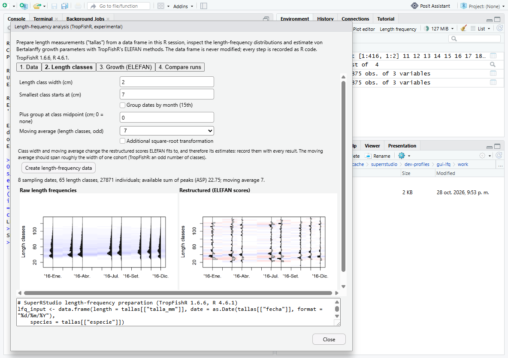
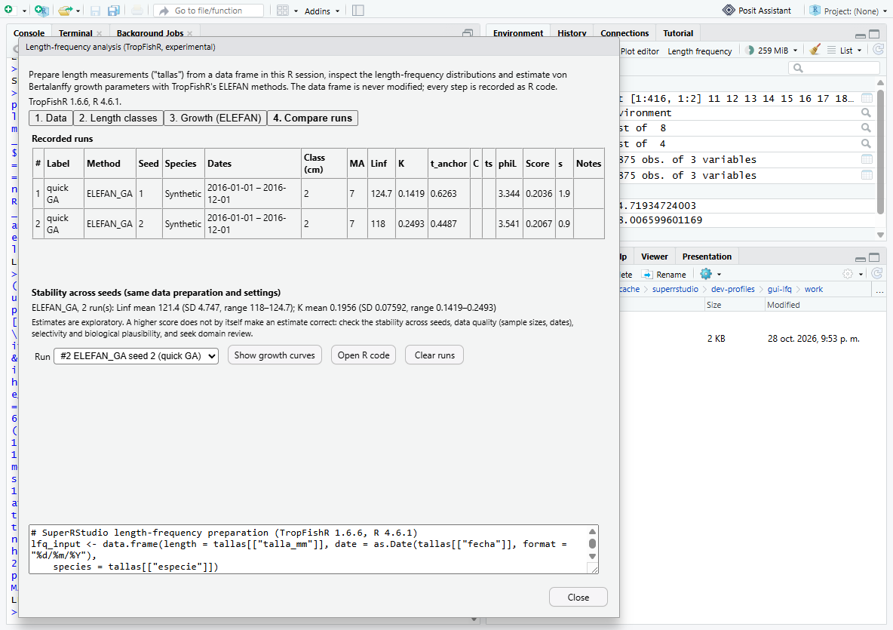

# Length-frequency analysis with TropFishR (Milestone E, first slice)

Status 2026-10-28: **experimental, desktop-verified**, opt-in with
`SUPER_RSTUDIO_EXPERIMENTAL=1` (Environment toolbar: *Length frequency*).
TropFishR is optional: without it the window explains how to install it and
the data checks still work. Scientific interpretation has **not** been
reviewed by a fisheries scientist yet; see *Limitations*.

## Why

Researchers working with length measurements ("tallas") report different
TropFishR results for what they believe is the same analysis. This module
does not assume a package bug. It makes every input that changes an ELEFAN
estimate visible and recorded, runs TropFishR's own functions unchanged, and
lets the same analysis be repeated with controlled seeds and compared.

Sources of differing results found in the installed TropFishR 1.6.6 source
and documentation (verified, not assumed):

| Source | Evidence |
| --- | --- |
| `ELEFAN_GA` is stochastic | `seed = NULL` by default; passed to `GA::ga(seed = )`. Same seed gives identical estimates; different seeds differ (synLFQ7 test: seed 1 Linf 124.7 / K 0.142, seed 2 Linf 118 / K 0.249 with a small GA). |
| `ELEFAN_SA` stops on wall-clock time by default | `SA_time = 60` sets `GenSA` `control$max.time`; GenSA's internal seed is fixed (`-100377`), so iteration-limited runs are reproducible but time-limited ones depend on computer speed and load. |
| Scores are not comparable across methods | `ELEFAN_GA` documentation: the fitness value "is not comparable with the score value of the other ELEFAN functions". |
| Restructuring settings | `MA` (odd number of classes) and `addl.sqrt` change the restructured scores every method fits to. |
| Length classes | `bin_size` and `Lmin` define the classes; `lfqCreate` adds one empty class above the largest length (`seq(Lmin, max + bin_size)`). |
| Silent data handling in `lfqCreate` | zero lengths dropped; negative lengths and lengths below `Lmin` fall outside every class and are ignored; `plus_group = TRUE` without a value waits for console input. |
| Search ranges | `ELEFAN_GA` derives its default Linf range from the data's largest class. |
| Date grouping | `aggregate_dates = TRUE` moves every sample to the 15th of its month. |

## Workflow

1. **Data**: choose a data frame, the length column and unit (cm, mm, m), the
   sampling-date column (Date/POSIXct, or text with an explicit format), an
   optional frequency column (aggregated data) and an optional species column
   and species. *Check data* reports, rule by rule, how many rows are removed
   (other species, missing/non-numeric length, zero or negative length,
   below the smallest class, missing or unparseable date, missing or negative
   frequency) and the number of individuals per sampling date.
2. **Length classes**: class width, smallest class, monthly date grouping,
   plus group (always passed as `c(TRUE, value)`), moving average and the
   additional square-root transformation. *Create* calls `lfqCreate()` and
   `lfqRestructure()` and shows TropFishR's own plots of the raw and
   restructured frequencies and the generated code.
3. **Growth (ELEFAN)**: `ELEFAN_GA` (seeds such as `1-10`, population,
   generations, stop rule, mutation, crossover, elitism), `ELEFAN_SA`
   (iteration or time limit, temperature, starting values) or `ELEFAN`
   (Linf/K grid), with explicit search ranges and optional seasonal growth.
   Every argument that affects the estimate is written explicitly in the
   recorded call. Runs execute in a separate `Rscript` process: the IDE and
   console stay usable, progress is reported and the run can be cancelled.
4. **Compare runs**: a table of every run (method, seed, species, dates,
   class width, moving average, Linf, K, t_anchor, C, ts, phi', score, time,
   warnings or errors), the spread across seeds for each configuration
   (mean, SD, range), notes when scores are not comparable, TropFishR's plot
   of the growth curves over the restructured data, and the complete R
   script of a run.

Each run records R and TropFishR versions and its full code (data
preparation + ELEFAN call), which reproduces its estimate from the user's
data frame. The data frame is never modified; analyses are refused if it
changed after the LFQ was created.

## Design

| Layer | File | Notes |
| --- | --- | --- |
| R | `src/cpp/session/modules/SessionSuperRStudioLfq.R` | `lfq_*` operations through the existing `superrstudio_data` RPC (no new RPC). Background runner script, job state, run records and comparison. |
| C++ | `SessionSuperRStudio.cpp` | Sources the second R file when the feature is enabled. |
| GWT | `views/superrstudio/LfqDialog.java`, `LfqResult.java`, `LfqMessages*` | Non-modal window with four WAI-ARIA tabs; English and Spanish messages (Spanish not yet compiled, as for the plot editor). |
| Toolbar | `EnvironmentPane.java` | *Length frequency* button, hidden unless the session reports the feature enabled. |

## Verification

| Check | Command | Result |
| --- | --- | --- |
| R contract | `Rscript tests\superrstudio\lfq-tropfishr.R` (isolated library, TropFishR 1.6.6) | PASS: synLFQ7 rebuilt from individual rows equals the reference counts (plus the empty top class) and equals direct `lfqCreate`/`lfqRestructure` (catch, rcounts, ASP); the emitted code reproduces the object; aggregated counts in mm with text dates give the same LFQ; per-rule removal counts; background `ELEFAN_GA` per seed, iteration-limited `ELEFAN_SA` and `ELEFAN` equal the same calls evaluated directly; spread across seeds; comparability notes; recorded code reproduces an estimate; cancellation kills the runner; stale data and invalid settings refused |
| R contract without TropFishR | same script on R 3.6.3 | PASS (missing-package path) |
| Live desktop | `tools\superrstudio\test-gui-scatter.ps1 -Scenario lfq` | PASS: report of removed rows (other species, missing length, zero length, impossible date 31/02) and per-date counts equal R; created LFQ (8 dates, 65 classes) and code reproduce synLFQ7 and the shown ASP; GA seeds 1-2 run in the background and the comparison mean equals the runs recomputed from their code in the console; during a long run the console answers and *Cancel* stops it; no client exceptions |

## Limitations and next steps

- Not yet reviewed by fisheries scientists; the guidance texts are
  descriptive, not methodological advice. Interpretation (selectivity,
  sampling design, cohort tracking) needs domain review.
- Only growth (ELEFAN family). Mortality, catch curves, yield per recruit and
  selectivity are later steps; `lfqModify` options (date subsets, merging
  fleets) are not exposed yet.
- `ELEFAN_GA` with `parallel = TRUE` is not offered (needs doRNG for
  reproducible seeds). Runs are kept for the session only; saved
  configurations are a next step.
- The fitted-curve plot uses TropFishR's base graphics (PNG), not the
  interactive plot editor.
