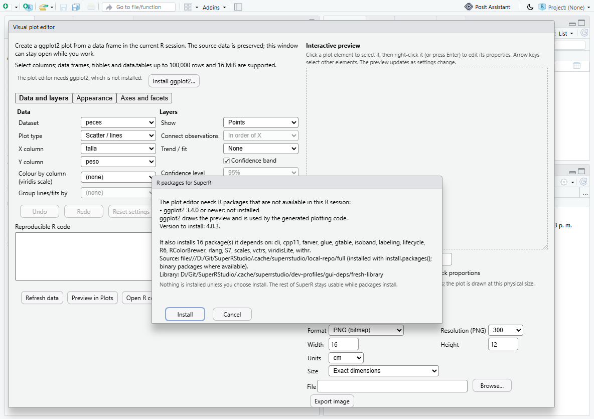

# Optional R packages, installed on request

SuperR starts without ggplot2, TropFishR or any other optional scientific
package. A SuperR window that needs one checks for it when the user opens
the window. If the package is missing, SuperR explains what an installation
would do and **installs only when the user chooses Install**. The rest of the
IDE works with or without these packages.

| Feature | Packages (minimum version) |
| --- | --- |
| Plot editor (Visual) | ggplot2 (3.4.0) |
| Length-frequency analysis | TropFishR (1.6.0) |

The list is `.rs.superrstudioDependencyFeatures()` in
`src/cpp/session/modules/SessionSuperRStudioDeps.R`.

## What the user sees

The check runs when the user opens the plot editor from the toolbar or menu,
or opens the length-frequency window. If every package is installed in a
compatible version, nothing is shown, so an installed package never prompts.

**When to prompt.** If a package is missing or too old, the dialog *R
packages for SuperR* opens. A Visual tab restored at start-up does not
prompt; it shows "The plot editor needs ggplot2, which is not installed"
with an *Install ggplot2…* button. After *Cancel*, the same button stays in
the window.

**The dialog shows:**
- the package, the minimum version, and why the feature needs it;
- the version the repository offers;
- the dependencies that would also be installed (only those missing);
- the source: the session's `options("repos")`. "@CRAN@" is shown and used
  as https://cloud.r-project.org;
- the target library: the first entry of `.libPaths()`;
- under renv, a note that the packages go into the project library only and
  that `renv.lock` is not changed (run `renv::snapshot()` to record them).

**Problems are explained instead of attempted.** In these cases *Install* is
disabled and the reason is shown:
- the repository cannot be read;
- the package is not available;
- the version offered is too old;
- the library is not writable.

**Install and Cancel.**
- *Install* runs `utils::install.packages()` for exactly the packages shown,
  into that library, in a separate Rscript process. The dialog shows the
  latest line of R's installation output and a *Stop installation* button,
  and the console and the rest of the IDE stay usable.
- On success the session checks the packages again. The dialog closes and
  the feature continues: the plot editor reloads its data, and the
  length-frequency window starts again with TropFishR.
- On failure, R's messages are shown and nothing is reported as installed.
- If the installation is stopped, any `00LOCK` folders left in the library
  are named.

## What is never done

- Nothing is installed without the user choosing Install.
- Nothing is installed at start-up, and nothing is updated in the
  background.
- Other libraries are not written: not the R installation's library, not
  another user library, and not a library outside the project under renv.
- `renv.lock`, `DESCRIPTION` and other project dependency files are not
  modified.

## Design notes

- The client has a single `superrstudio_data` RPC. Its operations
  (`deps_check`, `deps_plan`, `deps_install`, `deps_poll`, `deps_cancel`)
  carry the feature name in the dataset argument.
- The installer process gets the session's `.libPaths()`, the repositories,
  `type = .Platform$pkgType` (binary packages on Windows), and
  `dependencies = c("Depends", "Imports", "LinkingTo")`. It never compiles
  from source when no binary exists.
- Compatibility is checked with `utils::packageDescription(lib.loc =
  .libPaths())`. A namespace that is already loaded but no longer on the
  library paths (for example after loading a renv project) does not count as
  installed.
- Under renv the project library is the first library path, so packages go
  there. They are installed with `install.packages()`, not `renv::install()`.
  The renv cache is therefore not used, and the lockfile stays exactly as it
  was.
- Messages are in English and Spanish (`tools/superrstudio/i18n/deps_messages.py`
  generates `DependencyMessages` and `DependencyMessagesEs`).

## Verification

| Check | Command | Result (2026-10-29) |
| --- | --- | --- |
| R contract | `Rscript tests\superrstudio\deps.R` | PASS: missing package with plan; installation into the first library only, revalidated, not offered again, R library untouched; unavailable package and unreachable repository refused; broken package fails with a message; cancel; unwritable library refused; real renv 1.3.1 project: project library, `renv.lock` unchanged |
| Live desktop | `tools\superrstudio\test-gui-scatter.ps1 -Scenario deps` | PASS: fresh empty library, prompt with the plan, Cancel installs nothing and keeps the IDE usable, unavailable and broken packages, stop, successful installation that resumes the editor (preview drawn), no repeated prompt, the length-frequency window names TropFishR, a real renv project loaded in the session |

The tests use a local package repository (`tests/superrstudio/make-local-repo.R`
downloads ggplot2, its dependencies and renv from CRAN once into
`.cache/superrstudio/local-repo`) and temporary libraries. Installing from
the internet uses the same code path with the session's repositories.

