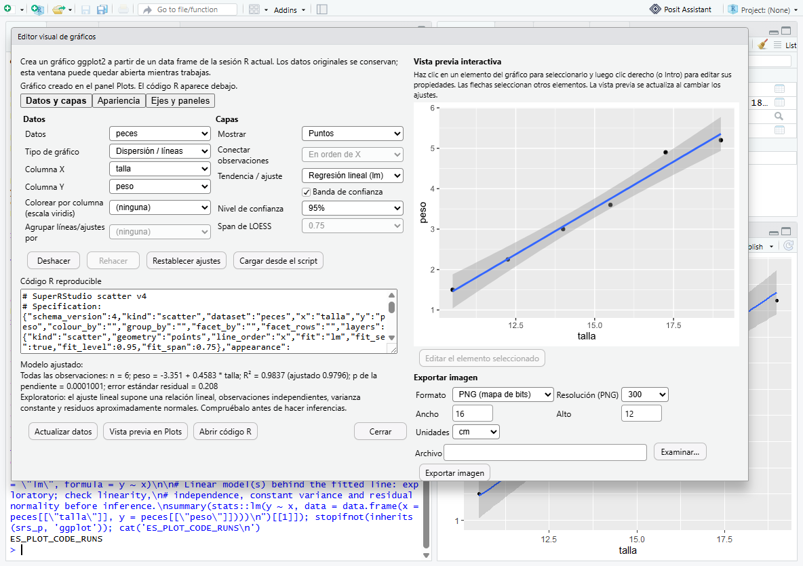
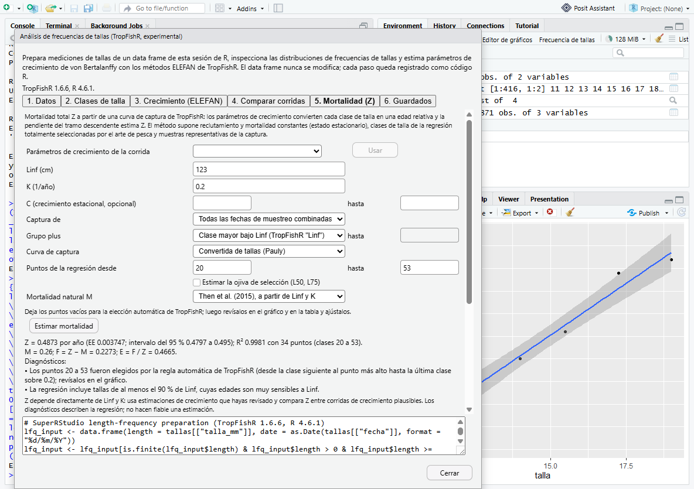

# Spanish user interface for SuperRStudio features

Status 2026-10-29: **desktop-verified** in the compiled development build.
Spanish uses Latin American wording (*tú*, "computador", "corrida").

## How to use it

In *Tools → Global Options → General → Advanced*, set *User Interface Language* to **Spanish (Español) - SuperRStudio features only**, then restart. The plot editor, the length-frequency window and their toolbar buttons appear in Spanish. RStudio's own interface stays in English, because no upstream Spanish translation exists and translating it is outside this milestone.

## Why not a GWT `es` locale

RStudio's GWT build compiles one set of messages per locale, and only `en` and `fr` are compiled. In the pinned sources, 108 upstream message interfaces keep all their text in `XxxConstants_en.properties` and `_fr.properties`, with no default resources.

We tried adding `es` as a GWT locale, with and without `fallback-value="en"`. The compilation fails: `No resource found for key 'visualEditorText'` in `PanmirrorConstants`, and likewise for the others. The i18n generator does not fall back from `es` to `en`.

A compiled `es` locale would therefore need 108 Spanish (or copied English) resource files for upstream text. That means a large upstream divergence with no translation value.

What we did instead:
- **The UI-language preference** gets a third value, `es`, in the schema, the generated accessors (`UserPrefsAccessor.UI_LANGUAGE_ES`, `kUiLanguageEs`) and the selector in General → Advanced (`PrefsConstants.spanishLabel`).
- **RStudio's existing start-up code** copies the preference into the `LOCALE` cookie. GWT finds no `es` permutation and uses its `en` fallback, so upstream screens are unchanged.
- **`SuperRStudioLanguage`** reads the cookie. When it is `es`, SuperRStudio windows use `ScatterMessagesEs` / `LfqMessagesEs`. These are plain Java classes generated from the Spanish `.properties` files, and they implement the same interfaces as the English `GWT.create` messages. If the language is anything else, nothing changes.
- **Electron** passes `es` to i18next, which falls back to English for desktop menus. This was verified with no errors.

## Rules for scientific content

- **Numbers keep the decimal point in both languages.**
  - Estimates, statistics and inputs all use `0.4873`, never `0,4873`. The R console, the generated code and the saved-analysis files use the same convention, so values can be copied between them without conversion.
  - Spanish prose follows the same rule: `0.2`, `1.5 × RIC`, `100 000 filas`.
  - Number fields accept only the decimal point; R rejects anything else with a message.
- **Dates use ISO `YYYY-MM-DD`.**
- **R syntax, function names, argument names and generated code are never translated.** The test evaluates the code produced in Spanish.
- **Messages computed in R are sent with stable codes and values**, and the window builds the sentence in its own language. This covers diagnostics, restore warnings and the categories of differences.
- **Validation errors raised by R for invalid input are still in English.** This is a known limitation.
- **Non-ASCII text in generated Java is written as `\uXXXX`.** It therefore does not depend on the compiler's file encoding.

## Maintaining the texts

| Interface | English | Spanish source | Generated |
| --- | --- | --- | --- |
| Length frequency | `LfqMessages.java` | `tools/superrstudio/i18n/lfq_messages.py` (one table with both languages) | `LfqMessages.java`, `LfqMessages_es.properties`, `LfqMessagesEs.java` |
| Plot editor | `ScatterMessages.java` (hand-written) | `ScatterMessages_es.properties` (hand-written, UTF-8) | `ScatterMessagesEs.java` |

- Run `python tools/superrstudio/i18n/lfq_messages.py`, which also runs `spanish_messages.py`, after changing any text.
- The generator stops on a Spanish key without an English method, or when the placeholders differ between the two languages.
- It reports keys that have no Spanish text; they show the English text.

## Defect found and fixed

The compiled Spanish window showed `Resolución` and `Examinar…` in the export panel. The English window showed `Browse…` too.

Five texts added in the previous session had been written with double-encoded UTF-8. They are repaired, and both desktop tests now fail on any `Ã`, `Â`, `â€` or U+FFFD in an open dialog.

## Verification

`tools\superrstudio\test-gui-scatter.ps1 -Scenario es` passes. It launches an isolated profile with `ui_language: "es"` and reads every expected text from the Spanish message files. It checks:
- the cookie becomes `es`, and upstream panes stay English;
- the Spanish toolbar labels;
- the plot editor in Spanish. Fitted-model numbers use a decimal point, and the generated code is unchanged and evaluates to a ggplot;
- the length-frequency window: tab names, data-check summary, transformations, catch-curve results, the diagnostics table and its header;
- restore warnings for a missing dataset;
- an accented analysis name (`Análisis de prueba`) written to the JSON file as UTF-8;
- no broken characters and no client exceptions.

The English scenarios (`ggplot2`, `no-ggplot2`, `disabled`, `lfq`) pass unchanged.

