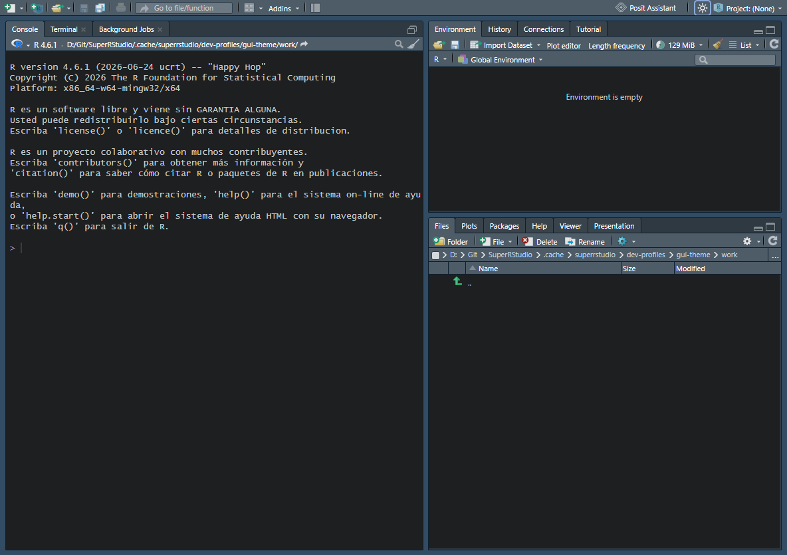

# One-click light/dark theme switch

Status 2026-10-29: **implemented and desktop-verified**. It is experimental and appears only with `SUPER_RSTUDIO_EXPERIMENTAL=1`.

## What it does

A sun/moon button sits at the right of the main toolbar, next to the project menu.
- **The icon shows what a click will do.** A moon switches to dark; a sun switches to light.
- **The tooltip and accessible name** say the same and name the target theme, for example *Switch to the dark theme (Tomorrow Night)*. The Spanish text is used when the interface language is Spanish.
- **Keyboard:** it is an ordinary button, so it takes Tab focus and responds to Enter and Space, with a visible focus outline.

## How it works (no second theme engine)

The switch does exactly what *Tools → Global Options → Appearance → Apply* does: it sets the global `editor_theme` preference and the applied `theme` user state, then writes both. RStudio's own machinery then changes the IDE, the editor, the dialogs and the SuperRStudio windows together. The change takes effect immediately, with no reload.

**Custom themes are preserved**
- The last light theme and the last dark theme in use are remembered, including themes chosen in Global Options or with `rstudioapi::applyTheme()`.
- Switching back therefore returns to them rather than to a default. For example, a user on Cobalt who switches to light and back gets Cobalt again.
- The built-in defaults, Textmate and Tomorrow Night, are used only until a theme of the other kind has been used.
- The remembered names live in the desktop profile's local storage; the applied theme itself is the normal RStudio preference.

## Verification

`tools\superrstudio\test-gui-scatter.ps1 -Scenario theme` launches one fresh profile three times.

1. **first**
   - The toggle starts light with the correct label.
   - Focus and Enter switch to dark (Tomorrow Night). The label changes and the focus outline is present.
   - A click switches back to light.
   - Cobalt applied through the R API is remembered: light, then dark again, gives Cobalt.
2. **restart:** Cobalt is still applied and the toggle offers Textmate. Switching to light keeps Cobalt remembered.
3. **off:** with the features disabled there is no toggle.

There are no client exceptions in any phase. The dark rendering of the SuperRStudio windows (contrast at least 4.5:1) is checked by the `ggplot2` scenario.

## Limitations

- **Project themes.** A project that sets its own editor theme keeps it: the toggle changes the global preference, as Global Options does.
- **Remembered themes are per desktop profile.** They are stored in local storage, not in the synced preferences.
