# Visual scatter plot (M3 first slice) — acceptance record

Status: **implemented and verified in the live Windows 11 desktop**, 2026-10-28,
branch `feature/visual-scatter`. Opt-in: the session must be started with
`SUPER_RSTUDIO_EXPERIMENTAL=1` (`tools\superrstudio\dev-run.ps1 -Experimental`).

## What a user can do

1. Create or import a data frame in the R console.
2. Click **Scatter** in the Environment toolbar (next to *Import Dataset*).
3. Choose a data frame and two numeric columns; only plain data frames with
   unique, non-empty column names and ordinary integer/double columns are offered.
4. **Preview in Plots** renders `ggplot2` in the active session; the Plots pane
   is brought forward and ggplot2 warnings (for example removed NA rows) appear
   in the dialog. **Open R code** opens the same reproducible code in a new,
   unsaved R script. The dataset is never modified or copied into the
   user's environment.

5. **Appearance** (added the same day, specification schema 2): plot title,
   X/Y axis titles, point colour (ggplot2 default or the colour-blind-safe
   Okabe-Ito palette), size, opacity and theme (grey, bw, minimal, classic,
   light). **Undo** steps back through appearance edits; **Reset appearance**
   restores ggplot2 defaults (and can itself be undone). Only non-default
   settings are emitted, so an unstyled plot still produces the minimal code.
6. **Colour by column**: map a numeric, character, factor or logical column
   to point colour, emitted as `colour = .data[["col"]]` inside `aes()` with a
   colour-blind-safe `scale_colour_viridis_d()` (categories) or
   `scale_colour_viridis_c()` (numbers). The fixed point colour is disabled
   while a column is mapped; R rejects requests combining both. Recorded as
   `colour_by` in the specification.

7. **Lines and fits** (specification schema 3). *Show*: points, connected
   lines, or lines and points. Connected lines always state their order:
   *in order of X* (`geom_line`, sorted within each group) or *in data-row
   order* (`geom_path`, only for rows that already form a sequence); the dialog
   explains the choice. Lines and fits can be grouped by a category (*Group
   lines/fits by*, `group = .data[["col"]]`). *Trend / fit*: none, linear
   regression (`geom_smooth(method = "lm", formula = y ~ x)`) or a LOESS
   smoother (`method = "loess"`, span 0.25-1), with optional confidence band
   and level (80-99 %). Line colour, width and type, and fit colour, are
   separate appearance settings.
8. **Fitted model panel.** For linear regression the dialog shows, per fitted
   group, n, the equation, R-squared, adjusted R-squared, the slope p-value and
   the residual standard error, all computed by `stats::lm()` on exactly the
   observations `geom_smooth()` uses, plus an explicit caveat that the fit is
   exploratory and its assumptions must be checked. Statistics are withheld
   (not invented) when a group has fewer than three observations or constant X.
   LOESS is reported as a descriptive smoother without an equation or R-squared.
   The exported script adds a `summary(stats::lm(...))` block that reproduces
   the model(s).

9. **Plot types** (same editor and specification, `kind`): *Scatter / lines*
   (everything above; a line chart is the connected-lines geometry), *Histogram*,
   *Boxplot*, *Bar chart (counts)* and *Density*. The editor relabels the
   column lists and shows only the controls that apply to the selected type.
   - Histogram: one numeric variable; the binning is always explicit
     (`bins = n`, default 30, or `binwidth = w`); fill colour, outline colour
     and opacity; optional discrete fill column (stacked counts,
     `scale_fill_viridis_d()`). Summary: finite n, non-finite values removed,
     binning used.
   - Boxplot: numeric response, optional discrete group; fill and outline
     colours; outliers can be hidden (`outlier.shape = NA`, they still count);
     observations can be overlaid with a seeded jitter
     (`position_jitter(width = 0.15, height = 0, seed = 1)`, deterministic).
     Summary per group: n, median, quartiles, whiskers and outlier count,
     computed exactly as ggplot2's `stat_boxplot()` (quantile type 7, 1.5 IQR).
   - Bar chart: counts of one categorical column (`geom_bar`, NA as its own
     bar), stacked, side by side (`position = "dodge"`) or as proportions
     (`position = "fill"`, y axis labelled "proportion"). Bars of summed values
     (`geom_col` over several rows per category) are deliberately not offered.
   - Density: kernel density of one numeric column (`geom_density`, ggplot2's
     default `nrd0` bandwidth times an explicit adjustment); per-group curves
     with a fill column. Summary: n and bandwidth per group (groups with fewer
     than two values are reported, not drawn).
   - Invalid combinations (Y for a histogram, numeric group, grouping lines on
     non-scatter kinds, fixed fill with a fill column) are rejected with a
     message; they are validated before the ggplot2 availability check.

10. **Non-modal editor window** (*Plot editor* button). The editor is a
   draggable, non-modal window opened at the left of the workbench, so the
   Plots pane, console and the rest of the IDE stay usable while it is open;
   only one editor is open at a time (the button brings it to the front). It
   is not a `ModalDialog`: there is no glass overlay, it is not registered with
   `ModalDialogTracker`, and Escape is handled only inside the editor. Data
   changed in the console while it is open is detected and must be refreshed.

11. **Tibbles and data.tables** are offered alongside data frames (labelled
   `name (tibble)` / `name (data.table)`); other `data.frame` subclasses such
   as `sf` are not. Staleness detection without copying: for data frames and
   tibbles the session keeps a reference and compares with `identical()`
   (copy-on-modify gives every R-level change a new object; measured 0.02 ms
   versus 33 ms to serialize a 15 MiB frame on each request); data.tables can
   change in place (`:=`, `set()`), so their content is snapshotted
   (serialized) instead. Verified with tibble 3.3.1 and data.table 1.18.6.1
   installed only in the isolated test library.

12. **Reopen a plot from its code** (*Load from script*). The editor reads the
   `# Specification: {...}` header of generated code in the active script
   (schema versions 1-3; missing settings keep their defaults), selects the
   dataset, and restores plot type, columns, layers and appearance as one
   undoable step; a preview then reproduces the same code. This is the
   structured-specification foundation for contextual editing: plot elements
   are edited through the specification, not by clicking a raster image.

Generated code (the header records the versioned specification and versions):

```r
# SuperRStudio scatter v2
# Specification: {"schema_version":2,"kind":"scatter","dataset":"fish","x":"length cm","y":"mass_g","appearance":{"title":"Fish \"length\" vs mass","x_label":"Length (cm)","y_label":"","colour":"#0072B2","size":3,"alpha":0.6,"theme":"classic"}}
# R: 4.6.1; ggplot2: 4.0.3
ggplot2::ggplot(fish, ggplot2::aes(x = .data[["length cm"]], y = .data[["mass_g"]])) +
  ggplot2::geom_point(colour = "#0072B2", size = 3, alpha = 0.6) +
  ggplot2::labs(title = "Fish \"length\" vs mass", x = "Length (cm)") +
  ggplot2::theme_classic()
```

Appearance is sent as a JSON object (sixth RPC parameter), converted to an R
list in C++ and validated by `.rs.superrstudioScatterAppearance` (known keys,
types, text <= 200 characters, colour name or `#RRGGBB`, size 0.5-10, opacity
0.05-1, whitelisted themes). Layers are language objects; the displayed code
joins their deparsed forms, and the evaluated expression is the same
left-associated sum.

## Interactive preview and contextual editing (Milestone A)

The editor shows R's own rendering of the plot beside the settings and keeps
it up to date as settings change (`render` operation: interactive preview
only; *Preview in Plots* still prints to the Plots pane). Click a plot element
to select it, right-click it (or press Enter, Shift+F10 or the context-menu
key on the focused preview; arrow keys move the selection) to open its
properties: points (colour, size, opacity), connected lines (colour, width,
type, order), the fitted curve (method, colour, band, level, span), bars,
boxes and density curves (fill, outline, opacity and their statistics
settings), the title, axis titles and axes, the legend (position) and the
panel (theme). Popup controls mirror the editor's own settings, so every
edit goes through the same validated specification, undo/redo history and
deterministic code generation; the browser's raster context menu is
suppressed over the plot.

How elements are identified (no SVG drawing-order indexes, no pixel reading):
`.rs.superrstudioInteractive` draws the same gtable that `print()` draws on
R's `svg()` device (a double-resolution PNG when layers hold more than 5,000
rows), then measures the named gtable layout cells (`title`, `xlab-b`,
`ylab-l`, `axis-*`, `guide-box-*`, `strip-*`, `panel*`) with
`grid::deviceLoc()` and maps each layer's `ggplot_build()` data through its
panel's `x.range`/`y.range` (panels matched to `layout$ROW/COL` by cell
position rank, so facets work). Layer roles come from the geom class
(`GeomPoint`, `GeomLine`/`GeomPath`, `GeomSmooth`, `GeomBar`/`GeomRect`,
`GeomBoxplot`, `GeomDensity`). The session's current graphics device is
restored. The image is shown through `` (SVG in an image never runs
scripts). Legend position is a new appearance setting (`legend_position`,
emitted after the complete theme).

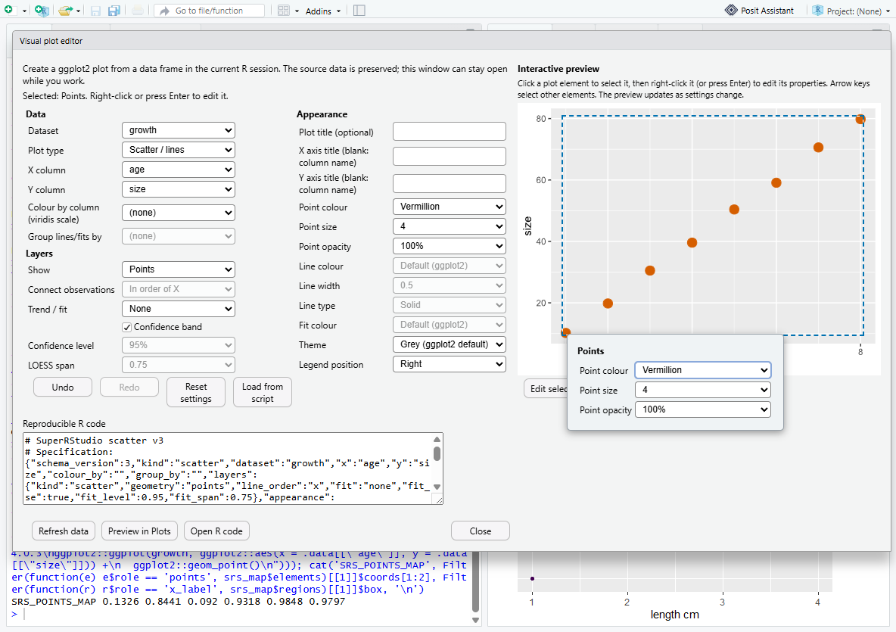
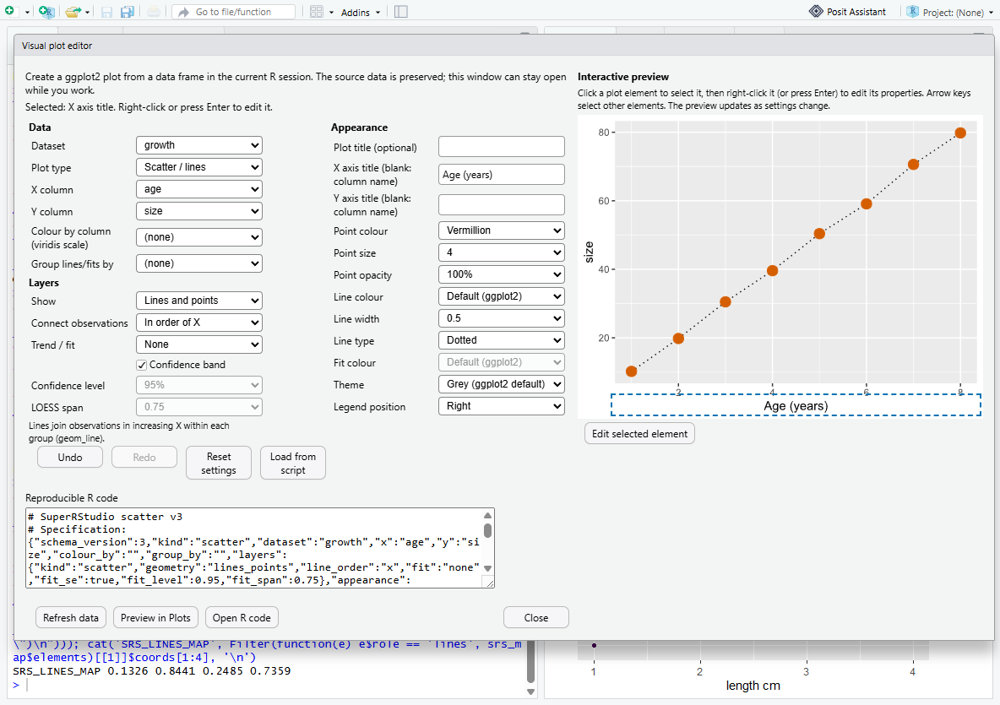

## Axes, scales and facets (Milestone B)

Settings are grouped in three tabs (*Data and layers*, *Appearance*, *Axes
and facets*; WAI-ARIA tabs with arrow-key navigation). Specification schema 4
adds an `axes` object and `facet_by`/`facet_rows`:

- **Scales**: linear or log10 per axis (log X for scatter, histogram and
  density; log Y for scatter and boxplot; never for counts or densities).
- **Limits**: *zoom* (`coord_cartesian`; every observation still enters
  fits, boxes, bins and densities) or *filter* (scale `limits`; observations
  outside are removed first, as ggplot2 does). Filtering computed Y values
  (counts, densities) is refused; log-scale limits must be positive.
- **Tick labels**: default, thousands separator, scientific or percent
  (`scales::label_*`, a ggplot2 dependency).
- **Gridlines**: major/minor on or off (after the complete theme).
- **Facets**: `facet_wrap` by one column (panel columns, fixed/free scales)
  or `facet_grid` rows (and columns).

Statistics describe exactly what is drawn: `.rs.superrstudioStatData`
applies filtering limits and log10 transforms (non-positive values dropped
and reported) before fits, box statistics, bins and bandwidths, and facets
join the grouping, so each panel has its own fit. The lm code states the
same subset and formula (for example `log10(y) ~ x` within `subset(...,
y > 0)` per panel). Notes explaining removed observations appear under the
model. Right-click on an axis opens its scale, limits and tick labels; on a
facet strip, panel columns and scales; on the panel, theme and gridlines.

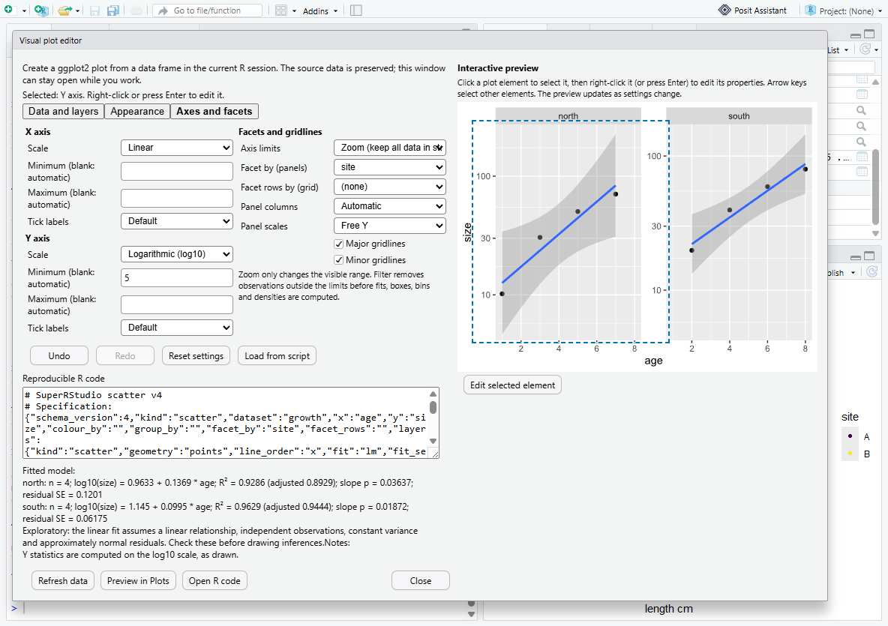

## Image export (Milestone D)

*Export image* under the preview writes the current plot with
`ggplot2::ggsave()`: PNG at a chosen resolution (150/300/600 dpi), SVG through
R's own `svg()` device and PDF through `cairo_pdf()` (embedded fonts), so no
extra package (such as svglite) is required. Width and height are given in
cm, mm or inches (0.5 to 50 inches). The file name is typed or chosen with
the IDE's save dialog; its extension must match the format, the folder must
exist, and nothing is written for an invalid request. The editor then shows
the export script (`plot <- ggplot2::ggplot(...)` followed by the exact
`ggsave()` call), which recreates the same file.

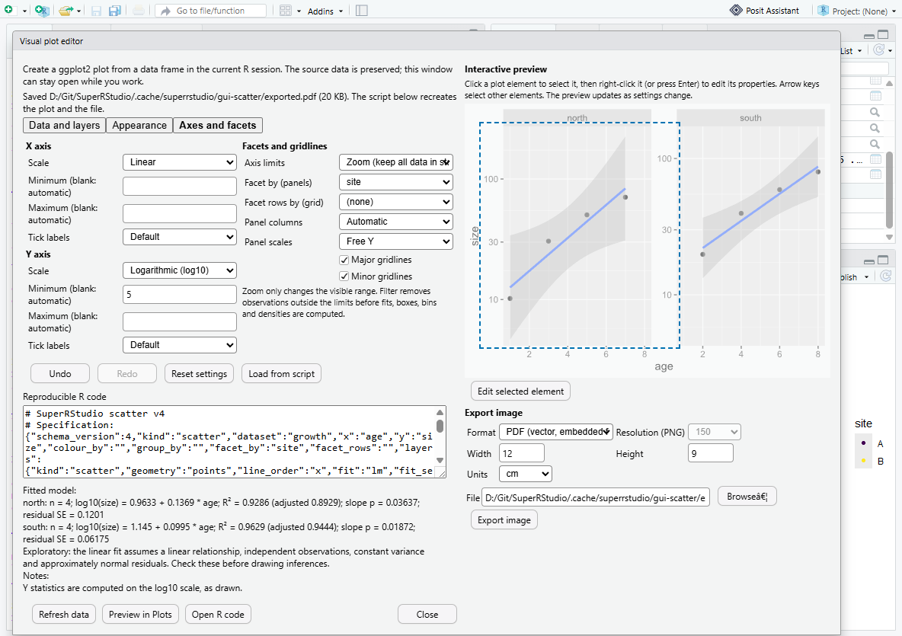

## Design

| Layer | File | Notes |
| --- | --- | --- |
| Session module | `src/cpp/session/modules/SessionSuperRStudio.{cpp,hpp,R}` | RPC `superrstudio_data` (`status`, `list`, `inspect`, `code`, `preview`, `release`); registered in `SessionMain.cpp`. Lists globals without forcing promises/active bindings. |
| R logic | `SessionSuperRStudio.R` | Code built as language objects (`substitute`/`deparse`), never by pasting user strings. A per-dialog revision plus serialized snapshot rejects data that changed after selection. Limits: 100,000 rows / 16 MiB. Validation failures are returned as data by `.rs.superrstudioDataRpc`, so they appear in the dialog and not in the console. |
| GWT | `workbench/views/superrstudio/*`, `EnvironmentPane.java` | `ScatterDialog` (ModalDialog; Close = Escape; ARIA status region), English messages plus `ScatterMessages_es.properties`. |

## Verification

| Check | Command | Result |
| --- | --- | --- |
| C++/GWT build | `tools\superrstudio\dev-build.ps1` | PASS |
| R contract, R 4.6.1 + ggplot2 4.0.3 | `Rscript tests\superrstudio\visual-scatter.R` (isolated `R_LIBS_USER`) | PASS (line order/grouping; lm estimates vs `lm()` and closed-form least squares, R-squared vs `cor()^2`, p-value, confidence band vs `predict()`, per-group fits, LOESS vs `stats::loess()`, too-few withheld; histogram bins/counts; box statistics equal `ggplot_build()`; bar counts vs `table()`; density bandwidth vs `bw.nrd0()` and curve vs `stats::density()`; seeded jitter deterministic; plot equivalence, injection-shaped column names, stale/deleted data, revisions, limits, RPC wrapper) |
| R contract, R 3.6.3 (no ggplot2) | same with R 3.6.3 | PASS (missing-package path); rendering SKIP |
| Upstream R-session suite | `tools\superrstudio\test-session.cmd` (with and without `experimental`) | 654 passed of 655 (1 skipped), as baseline |
| Live desktop, ggplot2 | `tools\superrstudio\test-gui-scatter.ps1` | PASS: histogram (bins, fill column, summary), boxplot (group, overlay, medians equal `quantile(type = 7)`, middles equal `median()`), lines + points with explicit order hint, lm fit with 90 % band (dialog R-squared equals `summary(lm())`, band equals `predict(..., interval = "confidence")`), LOESS summary, discovery, no-numeric frame, numeric columns, Plots pane shows new plot, dataset unchanged, generated code reproduces plot data, appearance edits + undo + reset, styled code reproduces title/axis/colour/theme, colour-by-column (2 viridis colours), export identical, no client exceptions |
| Live desktop, interactive editing | same (`ggplot2`) | PASS: right-click on a point series (position from the session's element map) opens *Points*; colour and size edits update the form, code and preview; undo/redo; right-click on the X axis title edits it; right-click on a line segment edits its line type; keyboard selection (arrows, Enter, Escape); live re-rendering adds nothing to the Plots pane; the final code reproduces colour, size, line type and axis title in R |
| R contract, axes and facets | `visual-scatter.R` | PASS: log10 fit equals `lm(log10(w) ~ log10(u))` on positive values and ggplot2's smooth; generated model code reproduces it; filter limits equal `lm()` on the subset (smooth too), zoom keeps all rows and the panel range equals the limits plus 5 % expansion; log zoom limits are data values; per-facet fits equal per-subset `lm()`; `facet_grid` rows; facet map has two panels and strips; comma/scientific labels; minor gridlines removed after `theme_bw()`; log boxplot medians equal `median(log10(.))` and `ggplot_build()`; log density bandwidth equals `bw.nrd0(log10(.))`; histogram counts after filtering; nine invalid combinations refused |
| Live desktop, axes and facets | `test-gui-scatter.ps1` | PASS: log Y + facet by site with per-panel lm summaries (`log10(size) = ...`), strip right-click sets free Y scales, Y-axis right-click sets a zoom minimum; console check: two panels, lower limit `log10(5)`, panel slope equals `lm(log10(size) ~ age)` for that site |
| R contract, export | `visual-scatter.R` | PASS: PNG signature and pixel size (width x dpi / 2.54, truncated as the device does), SVG `width="288pt" height="216pt"` for 4 x 3 in, PDF MediaBox 180 x 120 mm (read from inflated cairo object streams); running the returned export script reproduces byte-identical PNG and SVG files; wrong extension, missing folder, size out of range, unknown format and empty path refused without writing |
| Live desktop, export | `test-gui-scatter.ps1` | PASS: PNG 12 x 9 cm at 150 dpi and PDF exported from the editor (extension follows the format), export script shown, files checked from the R console |
| R contract, interactive map | `visual-scatter.R` | PASS: SVG and PNG variants, regions present, legend moved below the panel, point positions equal ggplot2's documented 5 % expansion arithmetic, fit paths, all plot kinds, device restored |
| Live desktop, no ggplot2 | same (`no-ggplot2`, empty library) | PASS: clean message in dialog, console unaffected, no device opened |
| Live desktop, disabled | same (`disabled`) | PASS: button hidden; ordinary IDE |

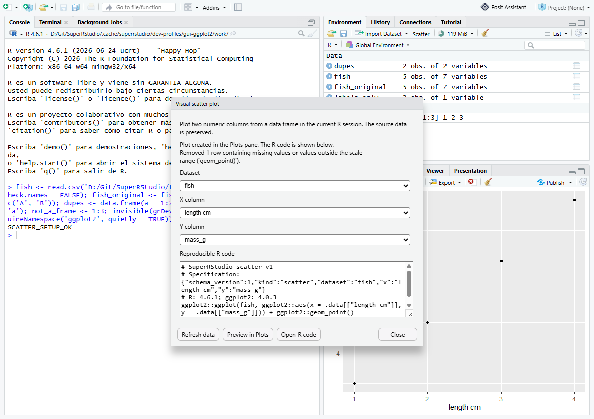
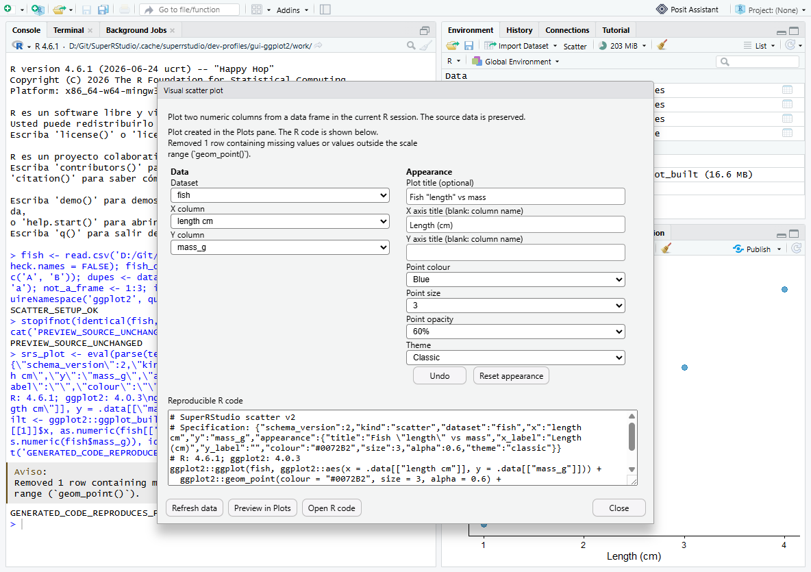
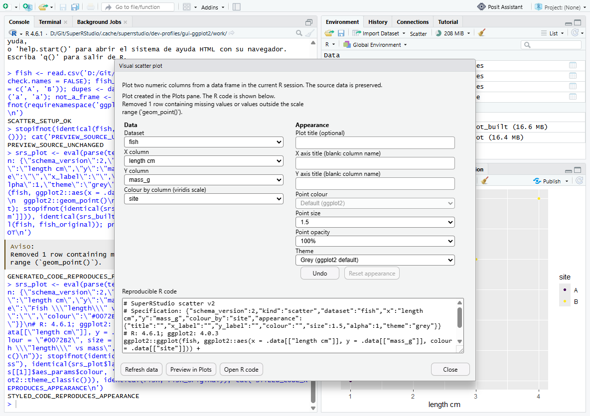
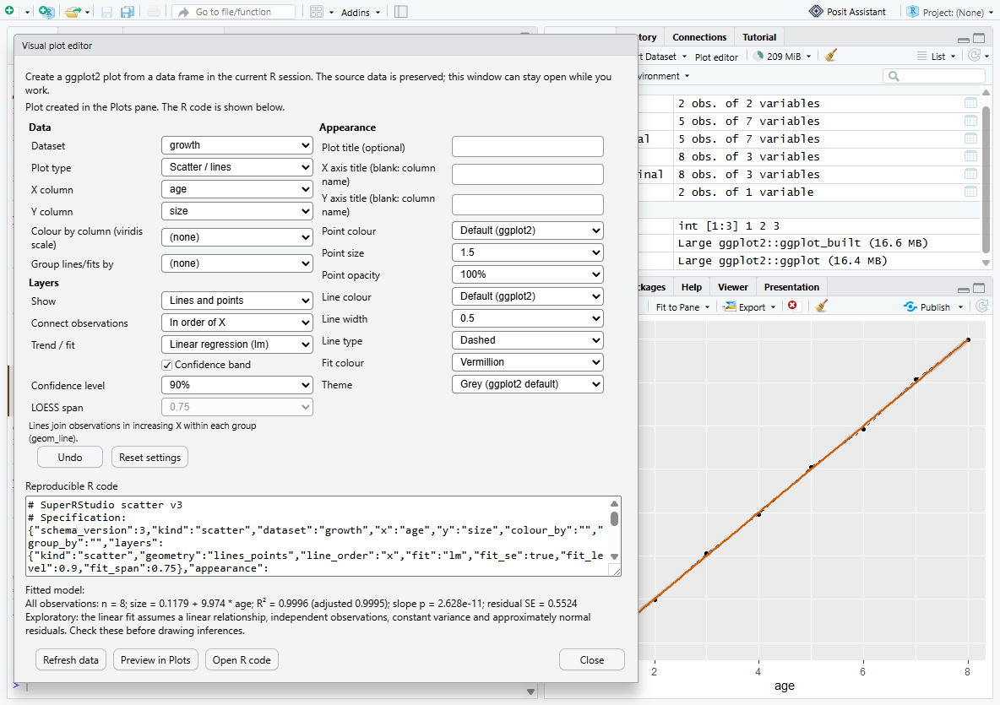
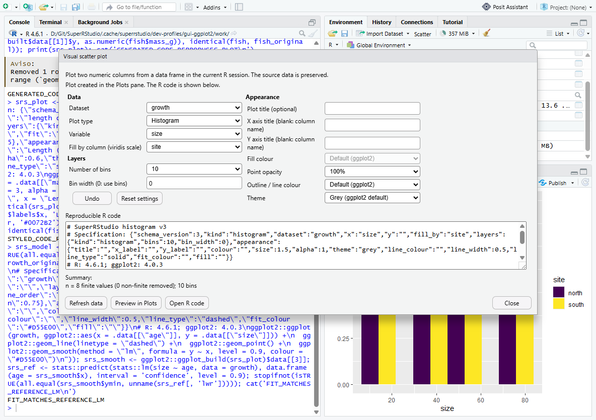
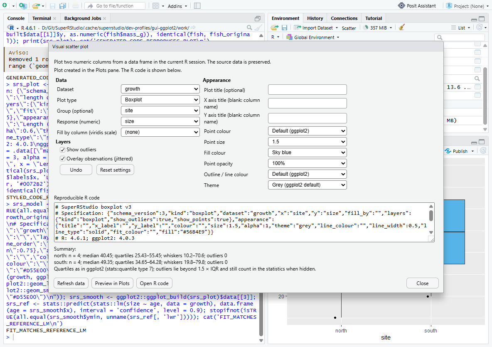
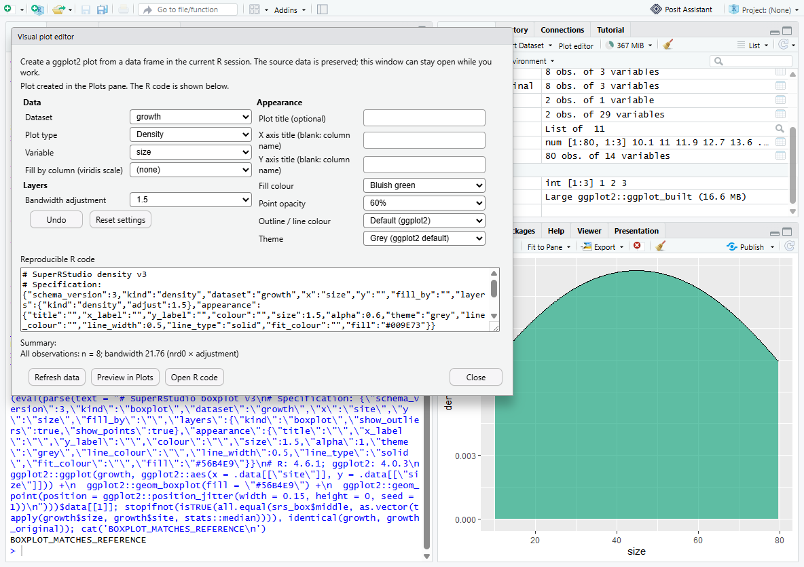
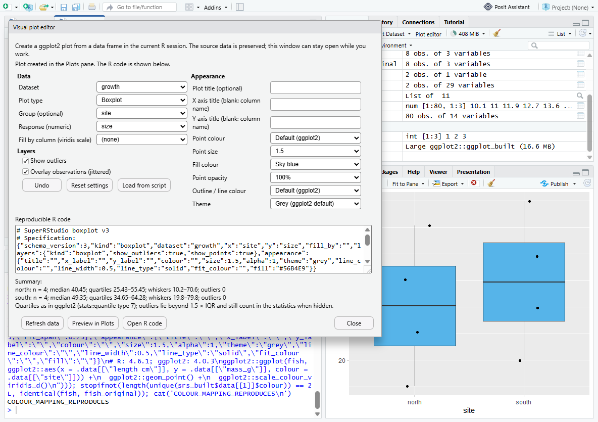
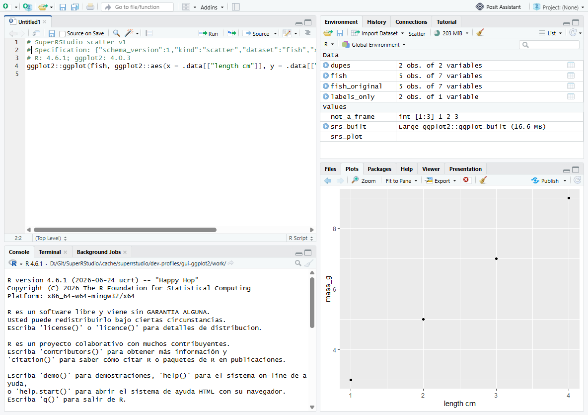
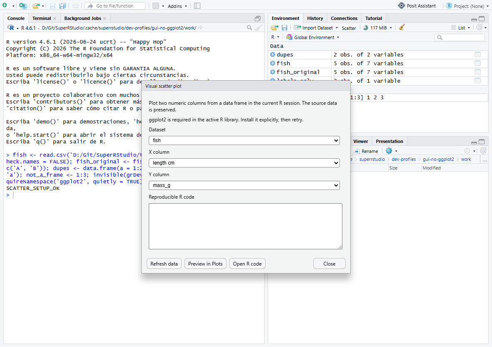

## Known limitations

- Spanish strings exist but are not compiled: the GWT module only builds
  `en,fr` (`RStudio.gwt.xml`). Adding `es` needs a locale permutation and the
  `ui_language` preference value; tracked for M7.
- Only global-environment objects; `sf` and other data.frame subclasses are
  excluded. An in-place modification of a plain data frame by C code (for
  example `data.table::set()` on a data.frame) is not detected.
- The editor is a floating window, not yet a dockable workbench pane.
- Contextual editing works per layer or element (all points of a layer), not
  per individual observation; editing a single observation would change data
  and is deliberately not offered. Hit targets for PNG previews come from the
  same map, but only the first 4,000 points per panel are hit-tested.
- Text appearance fields commit on blur/Enter (GWT value-change semantics);
  undo history is per dialog and not persisted.
